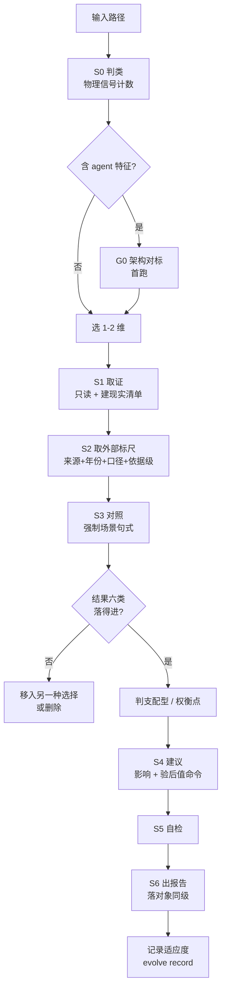

# 他山 · 以外观内的评审技能

> 「他山之石，可以攻玉」——用外部现实对照对象现实，只报**可验收的差距**。

一个给 AI agent 用的评审技能。输入一个路径，输出一份带证据的差距报告。不实施修改，不估工作量，不采信对象自己写的任何介绍。

---

## 目录

- [解决的问题](#解决的问题)
- [快速开始](#快速开始)
- [工作流程](#工作流程)
- [维度体系](#维度体系)
- [判据四层](#判据四层)
- [报告规范](#报告规范)
- [脚本](#脚本)
- [自进化机制](#自进化机制)
- [目录结构](#目录结构)
- [设计原则](#设计原则)
- [校准数据](#校准数据)
- [已知局限](#已知局限)

---

## 解决的问题

### 自评为什么会失真

任何自评系统都有三个结构性偏差：

| 偏差 | 表现 |
|---|---|
| 记忆污染 | 上一轮自己的报告成了这一轮的"事实来源" |
| 术语传染 | 开始用对象的家法词描述问题，判断被对象的框架绑住 |
| 标准松弛 | 自己给自己出题，题目会越出越容易 |

他山的解法全部是**机制**，不是态度：

- **唯一输入是路径**。对象的 `AGENTS.md`、`README`、状态卡、历史报告一律不作为证据，只作主张。
- **报告不与对象同置**。落到 `对象父目录/评审-<对象名>/`，切断"评审产出成为下轮输入"的自指。
- **报告零术语**。对象自己的体系名、卡片名、编号不进报告；需指认时用客观描述。
- **自评不免流程**。评自己时照常走全流程，报告头追加"自评局限：评审者与对象同源"。

### 与常见评审的差别

| 常见做法 | 他山 |
|---|---|
| "建议优化性能" | "当触发首屏时，当前 188 KB 未压缩，参照 gzip 后约 60 KB，差距多传约 128 KB；结果：等太久" |
| 列一堆改进项 | 每条必须落到六类结果之一，落不进的是审美偏好，不进主表 |
| 引用"业界最佳实践" | 每条参照必须给来源、内容年份、口径、依据等级；缺口径的数值不得使用 |
| 建议一律"应该做" | 先判是**支配型**（无条件做）还是**权衡点**（需裁决），不替决策者选 |

---

## 快速开始

把本目录放到 agent 的技能目录（如 `~/.agents/skills/他山/`），然后：

```
让他山评一下 D:/projects/my-app
```

或者直接跑脚本取证：

```bash
# 一键取证：规模、秘密字面量、界面分布
bash scripts/run.sh <目标目录>

# 复验量化指标（字号/颜色/断点/loading/按钮/标签）
python scripts/verify.py <目标目录>

# 共享样式表在别的目录时
python scripts/verify.py <目标目录> --with <共享tokens.css>
```

产物：

| 脚本 | 输出 |
|---|---|
| `run.sh` | `<目标目录>/评审/evidence/{probe,scan,ui}.json` |
| `verify.py` | 终端表格或 `--json` |

脚本只取形态证据，**不下结论**。判断、分级、外部对照都由评审者完成。

---

## 工作流程



**唯一停点**：路径不可读，或探针与人工都无法判定对象是什么。其余全自动。

---

## 维度体系

四类对象 × （通用 7 维 + 专属 2 维）。**每次只跑 1–2 维**，靠路由分文件控制加载量。

| 类 | 判据 | 专属维 |
|---|---|---|
| `code` | 有源码、入口文件、依赖清单 | **G0 架构对标（首跑）** ｜ A1 数据流分层 ｜ A2 测试校验 |
| `app` | 有部署编排、启动脚本 | B1 部署运维 ｜ B2 数据口径 |
| `skill` | 有 `SKILL.md` + description | C1 触发精度 ｜ C2 载荷冲突 |
| `os` | 纯 markdown、跨文件重复行 | D1 真相源唯一 ｜ D2 闭环分工 |

### 通用 7 维

| 维 | 问什么 |
|---|---|
| G1 有效性 | 声称的功能真的在用吗 |
| G2 效率 | 首屏、响应、传输字节 |
| G3 可靠 | 失败可恢复吗、状态可见吗 |
| G4 安全 | 暴露面、凭证、出口策略 |
| G5 结构 | 单文件职责、模块边界 |
| G6 交互 | 可读性、可操作性、可达性 |
| G7 互操作 | 接口契约、错误语义、版本兼容 |

### G0 架构对标（agent 类专属）

十个子系统逐个判「有 / 部分 / 无 / 不需要」：

推理循环 ｜ 上下文管理 ｜ 工具层 ｜ 沙盒 ｜ 记忆 ｜ 状态持久化 ｜ 编排 ｜ 可观测 ｜ 评估 ｜ 审批与边界

内核选型另按七维判是否"过时"：模型支持、上下文效率、子 agent、沙盒形态、持久化、扩展面、可观测。**三项以上落后且能追到结果影响才算过时**，否则记"保守"进权衡点。

---

## 判据四层

每层只回答一个问题，逐层收窄。

### 第一层 · 结果六类

每条差距必须落到一类，否则不是差距，是审美偏好。

| 结果 | 用户表现 | 可测形态 |
|---|---|---|
| 找不到 | 翻半天没入口 | 点击路径、首屏可见性 |
| 看不懂 | 读不出含义 | 字号、对比度、术语一致性 |
| 会做错 | 误操作 | 缺确认、缺校验、默认行为 |
| 等太久 | 等待无反馈 | 传输字节、状态缺失 |
| 用不了 | 键盘/读屏/低视力不可用 | 焦点、标签、语义角色 |
| 不敢信 | 不知是真是假 | 演示与真实无标识 |

### 第二层 · 依据四级

| 级 | 含义 | 是否进主表 |
|---|---|---|
| A 实证 | 可复现的测量或研究 | 进 |
| B 规范 | WCAG / ISO / RFC / ARIA 条文 | 进 |
| C 惯例 | 主流产品一致做法 | 进，须标"惯例" |
| D 偏好 | 无依据 | 不进 |

**年份不作淘汰理由**：1994 年的可用性启发式原则仍有效，2019 年的某个数字可能口径已失效。判据是"结果追不追得到、依据强不强"。

**阈值必须带口径**：188 KB 未压缩与 188 KB gzip 后是两个世界。口径缺失的数值不得使用。

### 第三层 · 支配判定

按六维（耗时 / 感知密度 / 服务器资源 / 暴露面 / 可维护性 / 交付成本）逐维判增平减：

| 结果 | 类型 | 处理 |
|---|---|---|
| 无一项变差、至少一项变好 | **支配型** | 无条件做，进主表 |
| 有一项变差 | **权衡点** | 单列，写"需裁决"，不计入 `found` |
| 全平 | 无收益 | 删除 |

**评审画前沿，不选点。** 选点需要权重，权重属于决策者。所以报告里不给前沿点排序、不做加权求总分——那会把隐式权重糊进一个数字，让冲突消失。

### 第四层 · 约束清单

"现有条件下最优"必须先有一张约束表：人力与时间窗、部署形态、资源上限、不可动接口、团队能力边界、交付期限。

缺表只能出阶段 A（支配型），阶段 B 标"待约束"，不替决策者假设。

**停止线**用 satisficing：设 3–6 条可测期望水平，达到即停，其余转"已知取舍"。

---

## 报告规范

### 落盘位置

```
<对象父目录>/评审-<对象名>/他山-<维度>-<YYYYMMDD>.md
```

报告不与对象同置；不可写时退到对象内 `评审/`，头注"退路落盘，下轮须排除"。

原文独立成文，**事后不改一字**；要批注，批注写在自己文件里。

### 骨架

| 节 | 内容 |
|---|---|
| 头注 | 对象类 / 维度 / 路径 / 取证时点 + 工作区状态 / 历史参照 / 计数 |
| 1 现实清单 | 事实 + `文件:行` |
| 2 参照源 | 来源 / 内容年份 / 口径 / 结果 / 依据级 / 为何可比 |
| 3 差距表 | 场景句式 / 结果 / 证据 / 影响面 / 偏离度 |
| 4 建议 | 改法 / **影响** / 验后值（命令）/ 依据 |
| 5 权衡点表 | 冲突维度 / 方案 A 代价 / 方案 B 代价 / 谁裁决 |
| 6 未查范围 | 项 / 原因 |
| 7 自检 | 逐条打勾 |

### 强制句式

> 当【触发条件】时，当前【事实 · `文件:行`】，参照【来源】的【度量】，差距【可判定差值】。结果：【六类之一】。

写不出这句就删掉这条。宁少不糊。

### 建议必须证明正向翻转

影响列写法固定：`<结果类>：<现状> → <之后>`。

- 数值必须可推算并写明推算方式（"文本 gzip 压缩比 3.0–3.5×"）
- 无法量化的写机制变化（"拦截点从人移到机器"），不写"提升质量/优化体验"
- **写不出正面影响的建议不进表**

### 条数不设下限

由证据决定。健康对象出 2 条是正确的输出。记 `found / new / carried / recur` 四个数，不用总数评价好坏。

---

## 脚本

| 脚本 | 作用 | 是否写对象目录 |
|---|---|---|
| `scripts/probe.py` | 规模、体积分布、类信号计数 | 否 |
| `scripts/scan.py` | 秘密字面量、危险模式（启发式） | 否 |
| `scripts/ui.py` | 断点、颜色/字号分布、可达性启发式 | 否 |
| `scripts/verify.py` | 复验量化值，D1–D2 同口径相减 | 否 |
| `scripts/run.sh` | 一键跑三者并校验输出可解析 | 是（`评审/evidence/`） |
| `schedule/tick.sh` | 定时批量取证 | 是（各对象 `评审/evidence/`） |

### 脚本失败降级

| 失败 | 替代 |
|---|---|
| 探针跑不起 | 人工 `find . -type f \| wc -l`、`du -sb .` |
| 扫描跑不起 | 该维记"未取证"，不得省略成"未发现" |
| 界面跑不起 | 退化为直接读 HTML/CSS 抽样 |

### 复验脚本的两个已知坑

| 坑 | 现象 | 修法 |
|---|---|---|
| 设计 token 在别的目录 | 单目录扫描报 0 字号 0 色 | `--with <共享css>` |
| 字号改用 CSS 变量 | `font-size:` 声明为 0，全走 `--fs-*` | 正则同时匹配两种写法 |

**对象做了正确的架构改进，反而可能让评审工具失效**——工具跟不上对象进步，会把好改动判成坏。

---

## 自进化机制

技能自己评审自己，记分、判退步、可回滚。

### 适应度公式

```
F = 0.35×修复率 + 0.25×(1−复发率) − 0.25×误报率
```

- 修复率 = `fixed / 上轮条数`
- 复发率 = `recur / 本轮条数`
- 误报率 = `(false_positive + 0.5×partial) / 上轮条数`，需外部复核数据
- 分母：未复核 0.60，已复核 0.85
- **未提供复核数据时该项不计**，分数带 `*`，表示不可与含该项的轮次直接比

### 只收结果项

公式曾含**载荷成本**（必读行数）与**新增条数**，两项都已移出：

| 移出的项 | 理由 |
|---|---|
| 载荷 | 输入量，不是结果。一个 500 行但零误报的技能优于 300 行但误报 25% 的 |
| 新增条数 | 新发现多可能意味着查得更深，惩罚它会奖励"少报" |

两者现在只做单列提示：载荷超预算打 `!`，新增条数留在表里。

### 可比性约束

趋势只在 **同对象 + 同维度 + 同公式** 之间计算。换维度或换公式即新基线。

ledger 每条记录带 `formula` 字段（f1 / f2 / f3），跨版本的分数不放在一起比。

### 判定规则

| 情况 | 判定 |
|---|---|
| 未下降 | KEEP |
| 下降 1 轮 | REGRESS，建议回滚 |
| 连续 2 轮下降 | STOP，停手等人裁定 |

回滚用 `evolve.py rollback --tag vN`；快照用 `snapshot --tag vN`。

### 用法

```bash
python scripts/evolve.py record --object "某对象" --kind code \
  --dims "G3,G1" --found 7 --new 7 --fixed 0 --lines 447
python scripts/evolve.py fitness
python scripts/evolve.py snapshot --tag v17
```

---

## 目录结构

```
他山/
├── SKILL.md              # 主入口：路由、流程、铁律（约 250 行）
├── dims/                 # 维度细则，按类加载
│   ├── common.md         #   通用 7 维 + 断言-证据匹配表
│   ├── arch.md           #   G0 架构对标（agent 类）
│   ├── code.md / app.md / os.md / skill.md
├── refs/                 # 参考资料，按阶段加载
│   ├── bench.md          #   外部标尺：结果六类 + 依据四级 + 阈值口径
│   ├── report.md         #   报告规范：骨架、句式、写作口径
│   └── tradeoff.md       #   支配判定、约束清单、停止线
├── scripts/              # 6 个可执行脚本
├── calibration/          # 误报库：校准样本，按对象分文件
├── schedule/             # 定时取证
├── versions/             # 版本快照 + CHANGELOG + ledger
└── _archive/             # 已废弃的引用文件
```

**加载策略**：`SKILL.md` + `dims/common.md` + `dims/<类>.md` + `refs/bench.md` + `refs/report.md` 是常态必读；`arch.md`、`tradeoff.md`、`calibration/` 按需加载。

---

## 设计原则

以下六条都是踩着具体错误总结出来的。

### 1. 断言类型决定证据类型

五类误报的共同模式：拿静态存在性证明行为性结论。

| 你断言的是 | 必须的证据 | 不足的证据 |
|---|---|---|
| 某机制不存在（无恢复/无清理） | 启动钩子、`finally`、调用方 | 单文件 `grep` 命中 0 |
| 只认某个配置值 | 解析函数、默认值合并、env 遍历 | 默认字面量 |
| 需要安装依赖 | `package.json` 的 `dependencies` 段 | 没有 `node_modules` |
| 已提交入库 | `git ls-files`、`check-ignore` | 目录存在 |
| 无标签/无名称 | DOM 包裹 + `label for` + 可访问名称 | `aria-label` 计数 |
| 无某种标识 | 任务级/响应级字段 + 界面元素 | 只查正文 |

**反向搜索要求**：断言"没有 X"之前，必须搜过 `recover` / `stale` / `expire` / `cleanup` / `ignore` / `fallback` / `default`。命中 0 只说明这个名字没出现。

### 2. 依赖包也算实现

能力可能在 npm / pip 依赖里，不在源码里。判定前先读清单。目录名也不等于能力——一个叫 `engine/pi/` 的目录可能只是自建工具集，内核在 `package.json` 里。

### 3. 口径先于数值

"188 KB"、"170 KB 预算"这类数字，不写清是 gzip 前还是后、是 JS 还是全部资源，就没有意义。口径缺失的数值一律不得使用。

### 4. 快照会污染静态检查

`versions/` 里存着历史完整副本，`grep` 不排除会把同一份定义数成十几份。人工统计必须加 `--exclude-dir=versions`。

### 5. 少报优于错报

一条误报的代价，是让对方花时间逐条复核反驳，还稀释了真问题的优先级。宁少不糊。

### 6. 评审画前沿，不选点

支配型可以直接说"做"；权衡点必须写清两头代价，由决策者定。评审者手里没有权重，就不该替人排序。

---

## 校准数据

`calibration/` 存的是**已发生的误判**，每轮开头读当前对象的样本（取 5 条），同一模式不重犯。

格式（JSONL，每行一条）：

```json
{
  "id": "FP-G6-07",
  "object": "某前端",
  "dimension": "G6",
  "claim": "4个输入无标签",
  "verdict": "false_positive",
  "why": "动态 input 均在 label.field 内，浏览器可得到可访问名称",
  "lesson": "标签检查看 DOM 包裹与可访问名称，不只看 aria-label 计数",
  "assert_type": "可达性"
}
```

`verdict` 取值：`false_positive` / `partial` / `true_positive` / `stale_snapshot` / `unit_mismatch` / `product_decision` / `gap_in_skill`。

文件名格式：`<对象>-<YYYYMMDD>.jsonl`。

---

## 已知局限

| 局限 | 说明 |
|---|---|
| 有效性未闭环 | F 只度量评审过程自身的稳定度，不证明"对外部对象有用"。真正的有效性要靠外部收敛率 `(D1−D2)/D1` |
| 静态证据为主 | 运行时行为（焦点陷阱、动态生成控件的可访问名称、真实并发）需要浏览器或压测，脚本不可判 |
| 自评有同源偏差 | 评自己时，评审者与对象同源，报告头必须标注 |
| 触发精度未验证 | 未在独立会话做正例加载测试 |
| 平台适配 | 只在 Windows + git bash + Python 3.7 验证过；POSIX 下未测 |
| 公式分辨率 | 三项公式容易接近满分，区分力有限 |
| 不做视觉判断 | 不截图比对，审美类问题不出结论 |

---

## 许可

未定。
