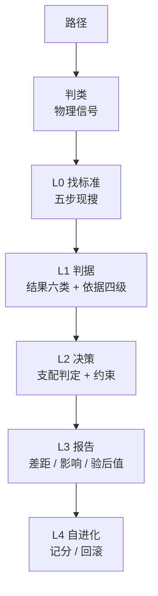

# 他山

> 给一个路径，出一份**能逐条验收**的差距清单——不是改进建议，不是评分，不是最佳实践套话。

名字取自「他山之石，可以攻玉」：以外观内，用别处的现实照这里的现实。

> **数据声明**：下文出现的 36 条、56%、22%、19 项分 9/10 等数字，均为 **2026-11 一次内部项目（6 个组件）的采样**，用于说明效果形态，不是普适结论。换对象、换时间，数字会变；方法不变。

---

## 一句话说清效果

| 没有它 | 有它 |
|---|---|
| "建议优化首屏性能" | "首屏 JS 158 KB 未压缩，gzip 后约 50 KB，多传 108 KB；结果：等太久" |
| "建议统一设计规范" | "两套色板各存 85 与 59 个色值，同一语义两处不同色；结果：看不懂" |
| "建议补充测试" | "6 个组件中 1 个零测试，`package.json` 无 test 脚本；结果：会做错" |
| 改完了不知道算不算改好 | 每条带验后值命令，跑一遍就知道达没达成 |
| 意见不合靠吵 | 支配型直接做，权衡点列两头代价，谁受益谁受损一目了然 |

---

## 效果一：差距可验收

### 每条的形态

> 当【触发条件】时，当前【事实 · `文件:行`】，参照【来源】的【度量】，差距【可判定差值】。结果：【六类之一】。

配一条**验后值**——下一轮量得到同一件事的命令。

### 真实交付记录

对一个约 30 万行的内部业务系统（6 个组件）做了 9 维体检，出 36 条差距。逐条验收的结果：

| 批次 | 原判 | 有效 | 已收敛 | 收敛率 |
|---|---|---|---|---|
| 前端交互 | 8 | 7 | 7 | **100%** |
| 效率与传输 | 8 | 8 | 5 | 62.5% |
| 结构与测试 | 6 | 4 | 1 | 25% |
| 代码结构 | 6 | 6 | 1 | 17% |
| 安全与互操作 | 9 | 7 | 未复评 | — |
| 可靠性 | 7 | 6 | 未复评 | — |

已复核部分：**有效 25 条，收敛 14 条，56%**。

其中前端那批的具体变化：

| 指标 | 评审前 | 修复后 | 验法 |
|---|---|---|---|
| 字号种类 / 最小 | 18 种 / 7.5px | 6 种 / 12px | `verify.py` |
| 颜色唯一值 | 85 | 30 | 同上 |
| 无 `type` 的 button | 21 | 0 | 同上 |
| `loading` 命中 | 0 | 9 | 同上 |
| 弱文字对比度 | 3.04:1 | 4.97:1 | 计算 |
| 1280 断点 | 无 | 有 | 断点列表 |

管理端随后同步收敛：字号 16 种/10.5px → 6 种/12px，59 个裸色值 → 0（改用共享 tokens），loading 0 → 29。

**这些不是"改好了"的自我声明，是脚本量出来的。**

---

## 效果二：判断可被推翻

### 误报率是公开的

同一批 36 条里，被对象方复核推翻：

| 类型 | 条数 | 例 |
|---|---|---|
| 完全误报 | 5 | "4 个输入无标签"——实际都在 `<label>` 内，浏览器有可访问名称 |
| 半误报 | 2 | "演示与真实响应不可区分"——任务响应其实已带 `mode` 字段 |
| 非缺陷 | 1 | "两套鉴权入口"——是产品决定，不是缺陷 |

合计 **8/36 = 22%**。

这个数字不进对象的收敛率，**进评审自己的账**。

### 误报被变成检查清单

五条误报全部出自同一个模式：**拿静态存在性证明行为性结论**。它们被写成校准样本（JSONL），每轮评审前读当前对象的那几条：

```json
{"claim":"任务槽无 stale 回收","verdict":"false_positive",
 "why":"启动时 recoverRunningTasks 将 running 置 failed",
 "lesson":"恢复断言追到启动路径与 store，不只看并发槽模块",
 "assert_type":"行为"}
```

并要求：**断言"没有 X"之前，必须搜过反义与替代实现**（`recover` / `stale` / `cleanup` / `ignore` / `fallback` / `default`）。命中 0 只说明这个名字没出现。

### 一个具体的翻车与纠正

评审一度判一个 HTTP 服务"缺持久化"，因为源码里 `memory` / `checkpoint` / `resume` 全部 0 命中。

反向搜索后发现：依赖里有 `pi-durable`，能力在包里不在源码里；同时 `compact` / `summarize` / `truncate` 各有多处命中，上下文管理已有雏形。

**结论从"缺三样"改成"缺一样"（人工审批点，`approval` / `confirm` / `handoff` 确实为 0）。**

---

## 效果三：优先级不用吵

### 两类优化的机械判别

对每条建议，按六维（耗时 / 感知密度 / 服务器资源 / 暴露面 / 可维护性 / 交付成本）逐项判增平减：

| 结果 | 类型 | 处理 |
|---|---|---|
| 无一项变差 | **支配型** | 无条件做 |
| 有一项变差 | **权衡点** | 列两头代价，谁裁决写清楚 |
| 全平 | 无收益 | 删掉 |

### 真实分类结果

同一批 19 个修复动作，分成了 9 / 10：

**无条件区（9 项）**：启用 gzip、清临时截图、补可访问名称、补加载态、边界规则扩到跨包、补测试、建 CI、审计日志落盘、演示标识扩到正文——**六维无一项变差**。

**权衡区（10 项）**，每项都能指出变差的那一维：

| 动作 | 变好的 | 变差的 |
|---|---|---|
| 加令牌 | 暴露面 | 每次调用多一步凭证，本地调试要配 |
| 鉴权默认开启 | 暴露面 | 演示环境默认被拦 |
| 前端按页拆 | 首屏 158→50 KB | 请求数 1→3–4，需要构建 |
| 单文件拆分 | 改动半径 2078→300 行 | 文件数↑、跨文件跳转↑ |
| 合并设计 token | 色值定义 2→1 处 | 两项目被迫同步升级 |

**效果**：不必在"性能与体验哪个重要"上辩论——先把代价列出来，谁受损、受多少，摆桌上。

### 评审画前沿，不选点

报告不给前沿点排序、不做加权求总分。加权求和会把隐式权重糊进一个数字，让冲突消失——而那正是要被看见的东西。选点需要权重，权重在决策者手里。

---

## 效果四：收敛可度量

```
收敛率 = (D1 − D2) / D1
```

- `D1` = 首次评审的有效条数
- `D2` = 修复后复评时仍未达成的条数

复验脚本同一个，判据同一套口径，不重写报告，只逐条比对。

前端的八条差距就是这样闭环的：D1 = 7 条有效（1 条误报已撤销）→ D2 = 0 条 → 收敛率 100%，其中 6 条脚本可复现、1 条静态可见（对话框焦点陷阱需运行时验证）。

**没有 D2 的报告，不得声称"变好了"。**

---

## 效果五：标准不会过期

### 技能里不存标准

早期版本把"某类系统该有哪十个组件"写进了技能。问题很明显：

| 存标准 | 后果 |
|---|---|
| 有现成清单 | 评审者停止搜索，只做勾选 |
| 半年后过期 | 拿旧尺子量新东西，还没人察觉 |
| 来自一家之言 | 变成某个作者的偏好，不是外部锚点 |

现在的做法：**标准每轮现搜**。

### 五步法

```
1 定结果目标   这次要改善六类中的哪一类，写不出就停
2 搜当下参照   同类对象实现 / 官方规范最新版 / 领域实证研究（榜单与营销页不用）
3 验可比性     一类事吗、规模差几级、有实现细节吗、能追到结果吗（任一否即弃）
4 查环境约束   部署形态、资源上限、运行时版本、不可动接口
5 对照与评价   场景句式 → 六类 → 支配判定
```

搜不到就写"缺外部参照"，该维只出事实不出评价。**宁可这轮不出结论，不可用编的参照出结论。**

### 两条口径纪律

- **阈值必须带口径**：188 KB 未压缩与 188 KB gzip 后是两个世界。口径缺失的数值不得使用。
- **年份只判依据是否失效，不作淘汰理由**：1994 年的可用性启发式原则仍有效；2019 年的某个数字可能口径早就错了。

---

## 效果六：边界清楚

### 静态证据说不了的话，明确说不

| 判不了 | 处置 |
|---|---|
| 焦点陷阱、Esc 回焦 | 标"静态可见，运行时未验证" |
| 动态生成控件的可访问名称 | 记"待运行时验" |
| 真实并发与压力行为 | 不进结论 |
| 线上是否已暴露 | 代码评审只判"代码未做" |

### 工具跟不上的时候

一次复评里，对象把字号与色板全迁到共享 `tokens.css`，复验脚本只扫单目录，**把管理端报成 0 字号 / 0 色**。

照脚本读，这批复评会全判"未达成"。

**对象做了正确的架构改进，反而让评审工具失效**——工具跟不上对象进步，会把好改动判成坏。已补 `--with` 参数与 CSS 变量识别。

---

## 效果七：自进化不虚

技能评审自己，记分、判退步、可回滚。

### 只收结果项

```
F = 0.35×修复率 + 0.25×(1−复发率) − 0.25×误报率
```

曾含**载荷成本**与**新增条数**，两项都已移出：

| 移出的项 | 理由 |
|---|---|
| 载荷 | 输入量不是结果。500 行但零误报，优于 300 行但误报 25% |
| 新增条数 | 新发现多可能是查得更深；惩罚它会奖励"少报" |

### 真实拦停记录

| 轮次 | F | 结论 |
|---|---|---|
| R11 | 0.597 | — |
| R12 | 0.903 | 修了上轮 6 条中的 5 条 |
| R13 | 0.854 | 修了 4 条中的 3 条 |
| R14 | **0.417** | 上一轮 4 条建议一条没做，却开了新方向 → **STOP** |

STOP 那轮的自评原文：*"不是做错了，是没收敛——上一轮列出的 4 条晾着，直接开了新方向。"*

停下后集中收敛 6 项，R15 回到 1.0。

### 一轮自评抓到的真 bug

```python
WEIGHTS = {"fix": 0.35, "recur": 0.25, "fp": 0.25}   # 常量

def score(rec, prev):
    raw = 0.35 * fixed_rate + 0.25 * (1 - recur_rate)   # 字面量
```

两行平行：指纹取常量的哈希，算分用字面量。改权重时自检报"无变化"，而口径实际已变——**防护等于没装**。

修完验证：`WEIGHTS["fix"]` 由 0.35 改 0.5，F 从 1.0 变 1.25。

这是同一个病灶的第 5 次出现：**声明有、接入无**。前四次在别的对象上，这次在自己的自检代码里。

---

## 架构：五层收窄



| 层 | 回答 | 硬约束 |
|---|---|---|
| L0 找标准 | 这次用哪把尺子 | 现搜；缺口径与可比性的弃用 |
| L1 判据 | 这条差距成立吗、凭什么 | 落不进六类的是审美偏好；D 级依据不进主表 |
| L2 决策 | 该不该无条件做、什么条件下算最优 | 有维度变差即权衡点；约束未定只出阶段 A |
| L3 报告 | 怎么写 | 场景句式；影响必须正向；验后值到命令级 |
| L4 自进化 | 技能自己有没有退步 | 同对象 + 同维度 + 同公式才可比 |

### 加载策略

必读约 590 行（主入口 + 通用维 + 类维 + 标尺 + 报告规范），其余按需：

| 按需文件 | 什么时候读 |
|---|---|
| `refs/standard.md` | 找标准（每轮） |
| `refs/tradeoff.md` | 出报告时做支配判定 |
| `dims/arch.md` | 对象有架构层可评时 |
| `calibration/<对象>-*.jsonl` | 开头取 5 条误报 |

---

## 快速开始

把本目录放到技能目录（如 `~/.agents/skills/他山/`），然后：

```
让他山评一下 D:/projects/my-app
```

或直接跑脚本：

```bash
bash scripts/run.sh <目标目录>                      # 取证：规模 / 秘密 / 界面分布
python scripts/verify.py <目标目录>                 # 复验：字号 / 颜色 / 断点 / 加载 / 标签
python scripts/verify.py <目标目录> --with <共享css> # 设计 token 在别处时
```

```bash
python scripts/evolve.py record --object X --dims "G6" --found 8 --new 3 --carried 4 --recur 1
python scripts/evolve.py fitness                    # 看趋势与判定
```

---

## 目录结构

```
他山/
├── SKILL.md              主入口：路由、流程、铁律
├── dims/                 维度细则，按类加载
│   ├── common.md           通用 7 维 + 断言-证据匹配表
│   ├── arch.md             架构对标（通用，无领域清单）
│   └── code.md / app.md / os.md / skill.md
├── refs/                 参考，按阶段加载
│   ├── standard.md         五步找标准
│   ├── bench.md            结果六类 + 依据四级 + 口径纪律
│   ├── report.md           报告骨架与写作口径
│   ├── tradeoff.md         支配判定、约束清单、停止线
│   └── samples/            历史检索采样（看格式，不当尺子）
├── scripts/              6 个可执行脚本
├── calibration/          误报库，按对象分文件
├── schedule/             定时取证
└── versions/             快照 + CHANGELOG + ledger
```

---

## 代价（不藏）

| 代价 | 量 |
|---|---|
| 必读体量 | 约 590 行，超自定预算 84%（已作门槛处理，不计分） |
| 每轮要联网搜 | 标准不预置，每轮现搜 3–5 条参照 |
| 误报率 | 首批 22%，需外部复核才能降；校准库是应对手段不是消除 |
| 静态为主 | 运行时行为看不到，只能标"未验证" |
| 产出的是差距不是修复 | 从差距到改好，中间是别人的工作 |

---

## 与其他做法的差别

| | 常见评审 | 他山 |
|---|---|---|
| 输入 | 文档、说明、自述 | **只要路径**；对象自己的说明不算证据 |
| 标准 | 内置清单或"业界普遍认为" | 每轮现搜，带年份与口径 |
| 输出 | 改进建议列表 | 场景句式的差距 + 验后值命令 |
| 优先级 | 凭经验排序 | 支配型 / 权衡点机械判别 |
| 有效性 | 难以验证 | 收敛率 `(D1−D2)/D1` |
| 误报 | 通常不统计 | 公开记数，进评审自己的账 |

---

## 已知局限

| 局限 | 说明 |
|---|---|
| 不证明"有用" | F 只度量评审过程是否稳，不证明对外部对象有正面效果；这要靠外部收敛率 |
| 自评同源 | 评自己时评审者与对象同源，报告头必须标注 |
| 触发精度未验证 | 未在独立会话做正例加载测试 |
| 平台 | 只在 Windows + git bash + Python 3.7 验证过 |
| 公式分辨率 | 三项公式容易接近满分，区分力有限；F=1.0 不等于健康 |
| 不做视觉判断 | 不截图比对，审美类不出结论 |

---

## 许可

未定。
